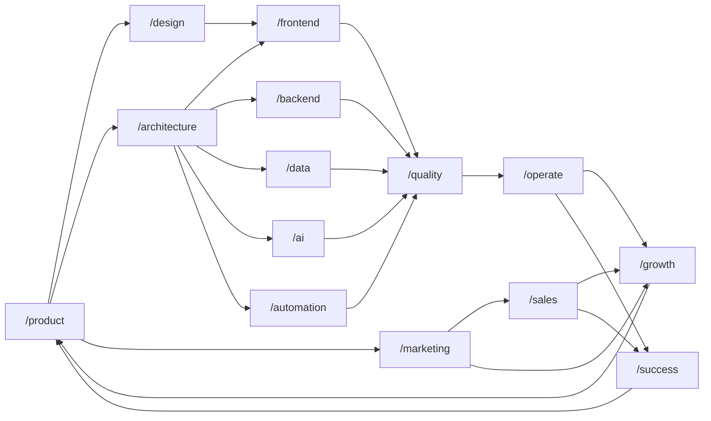
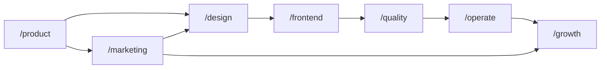
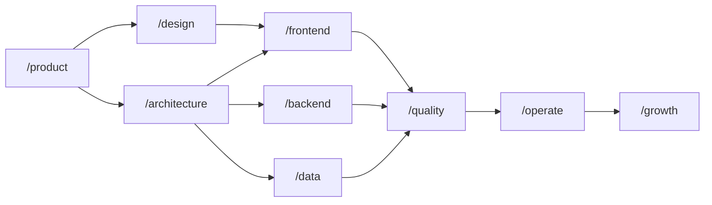
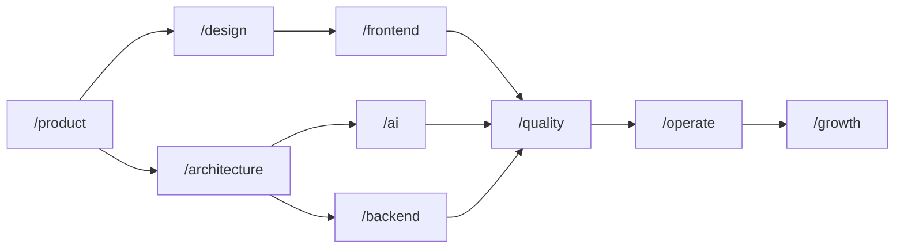
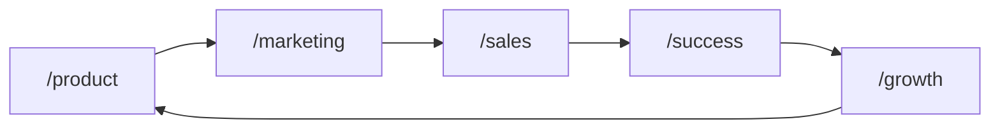

# Composable Skill Packs for the Digital Product Lifecycle

Status: canonical taxonomy and ownership model; remaining validation questions are listed in Section 16
Date: 2026-07-16
Audience: skill authors, agent-workflow designers, and maintainers of the skill repositories and discovery surfaces

Documentation map: [Digital Product Skills documentation](README.md)

Related research: [Skill-Pack Navigation and Steering Research](skill-pack-navigation-and-steering-research.md)

Authoring standard: [High-Signal Skill Authoring Standard](high-signal-skill-authoring-standard.md)

Repository and release decision: [ADR-0003: Independent skill repositories](decisions/0003-independent-skill-repositories.md)

Identity and terminology decision: [ADR-0002: Product identity and terminology](decisions/0002-product-identity-and-terminology.md)

## Executive conclusion

Build **Digital Product Skills** as fourteen independent domain skills:

```text
/product
/design
/architecture
/frontend
/backend
/data
/ai
/automation
/quality
/operate
/marketing
/sales
/growth
/success
```

Build `/digital-product` as a separate lifecycle composition skill. It selects the necessary domain skills, turns their work into a dependency graph, tracks progress and artifacts, validates stage gates, and routes feedback until the end-to-end objective is complete.

Keep `/orchestrate` separate. It coordinates multi-agent work and has no responsibility for defining the digital-product lifecycle. `/digital-product` may optionally use it as an execution mechanism, but must also work without it.

Names shown as `/design` or `/frontend` are compact catalog and diagram shorthand. The canonical skill identifiers are `design` and `frontend`; explicit invocation syntax is client-specific. For example, Codex commonly uses `$design`. The slash notation is not a runtime packaging requirement.

Each domain skill must:

- Work when invoked by itself.
- Own a coherent domain, workflow, and set of artifacts.
- Accept upstream artifacts when used in a pipeline.
- Produce a small, consistent handoff in pipeline mode or when downstream work is expected.
- Avoid assuming that another pack has already run.
- Recommend related packs without automatically invoking them.
- Keep variants such as website, web app, iOS, and Android inside references rather than turning every variant into another installed skill.

The categories shown on a website should be navigation metadata, not filesystem nesting or runtime dependencies:

| Lifecycle category | Independent packs |
|---|---|
| Discover | `/product` |
| Shape | `/design`, `/architecture` |
| Build | `/frontend`, `/backend`, `/data`, `/ai`, `/automation` |
| Assure | `/quality` |
| Run | `/operate` |
| Distribute | `/marketing`, `/sales` |
| Improve | `/growth`, `/success` |
| Compose | `/digital-product` |

This produces a system that is broad enough to cover an end-to-end product lifecycle without fragmenting the work into dozens of atomic skills.

## 1. Problem being solved

The original domain list mixed several different classification axes:

- Lifecycle stages: discovery, design, build, launch, growth.
- Product surfaces: website, web app, iOS, Android.
- Technical layers: frontend, backend, data, AI, automation.
- Practices: UX, UI, web design, web development, SEO, marketing, sales.
- Cross-cutting qualities: accessibility, security, privacy, performance, reliability.
- Coordination mechanisms: orchestration and agent workflows.

Putting all of these at one hierarchy level creates overlaps and unclear ownership. For example:

- SEO is simultaneously a marketing strategy, an information-architecture concern, a frontend implementation concern, and a quality-audit concern.
- A prototype may be a design artifact, a technical feasibility spike, a production-shaped experiment, or a growth experiment.
- A user journey can mean the complete customer lifecycle, an in-product task flow, a buying journey, or an onboarding journey.
- AI can be part of the product, a backend capability, or an automation step.

The solution is not a deeper hierarchy. It is a set of peer domain capabilities with clear ownership boundaries and explicit handoffs, plus one composition skill that connects them for an end-to-end objective.

## 2. Core architectural decisions

### 2.1 Use peer domain skills plus one composition skill

Every domain skill is individually installable and invocable. `/design` does not live inside `/product`; `/frontend` does not live inside `/design`; and `/marketing` does not live inside `/growth`.

The lifecycle is a composition model, not a package hierarchy. `/digital-product` depends on the public behavior of installed domain skills; it does not contain or own their source.

### 2.2 Use short canonical skill names

The fourteen domain identifiers are concise one-word handles. The lifecycle composer uses the clear compound identifier `digital-product`. Catalog display names and activation descriptions provide precision. Documentation may show an identifier with a leading slash for readability, but clients may expose `$name`, `@name`, slash commands, or natural-language activation.

Examples:

| Documentation shorthand | Suggested display name | Purpose in one sentence |
|---|---|---|
| `/product` | Product Strategy | Decide what to build, for whom, why, and how success will be measured. |
| `/design` | Experience Design | Design how people understand, navigate, and interact with the product. |
| `/architecture` | Product Architecture | Shape the technical system, boundaries, contracts, and non-functional requirements. |
| `/frontend` | Frontend Engineering | Implement production user interfaces across web and mobile surfaces. |
| `/backend` | Backend Engineering | Implement product services, APIs, data persistence, jobs, and integrations. |
| `/data` | Data Engineering | Make product and business data trustworthy, governed, and usable. |
| `/ai` | AI Systems | Build model-powered product behavior, agents, retrieval, and evaluations. |
| `/automation` | Workflow Automation | Build reliable cross-system and human-in-the-loop processes. |
| `/quality` | Product Quality | Independently verify functionality, usability, accessibility, security, and performance. |
| `/operate` | Product Operations | Release, observe, secure, recover, and sustain the production system. |
| `/marketing` | Product Marketing | Position the product and generate or capture market demand. |
| `/sales` | Sales | Convert qualified demand into committed customers. |
| `/growth` | Product Growth | Improve acquisition, activation, retention, referral, and revenue through experiments. |
| `/success` | Customer Success | Help customers adopt the product, realize value, renew, and expand. |
| `/digital-product` | Digital Product Lifecycle | Compose the relevant domain skills into a tracked, validated product lifecycle. |

Short names are necessarily broad. Trigger precision must therefore live in each skill's `description`, which should explain both what the skill does and the user requests that should activate it.

### 2.3 Group skills on the website without nesting the installed packs

Categories such as Discover, Build, or Improve help people browse the catalog. They should be represented as catalog tags or UI groupings. They should not create paths such as `build/frontend` or make `/frontend` depend on a `/build` skill.

This distinction preserves:

- Independent installation.
- Direct invocation.
- Clear triggering.
- Arbitrary pipeline composition.
- The ability to recategorize the website without renaming packages.

Do not add category metadata to `SKILL.md` frontmatter if the target skill format only supports `name` and `description`. Store display names, categories, compatibility, and storefront metadata in each repository. An optional aggregate catalog may index those declarations without becoming their source of truth.

### 2.4 Model a pipeline as a directed graph, not one mandatory sequence

Real product delivery is not a waterfall. Some work is sequential, some is parallel, and most stages have feedback loops.



These arrows show common artifact handoffs, not required dependencies. `/digital-product` selects the necessary subset, changes the order when evidence requires it, and permits parallel work when dependencies allow it.

### 2.5 Separate domain ownership from cross-cutting participation

A pack has one primary owner for an outcome, but other packs may contribute.

For example, `/marketing` owns SEO outcomes, while `/design`, `/frontend`, `/backend`, `/data`, `/quality`, and `/growth` each contribute to SEO. This is better than duplicating a complete SEO workflow in every pack or creating highly atomic skills for each SEO subtask.

## 3. Shared behavior of every domain skill

### 3.1 Standalone mode

When invoked by itself, a pack should:

1. Inspect the available request, repository, and artifacts.
2. Infer low-risk context when possible.
3. Ask only for information whose absence would materially change the result.
4. Complete its domain workflow without requiring another skill.
5. State important assumptions and unresolved questions.
6. Produce usable domain artifacts.
7. Recommend optional follow-on packs without invoking them automatically.

Example standalone requests:

```text
/design redesign this checkout flow
/architecture review this proposed multi-tenant system
/frontend build this responsive landing page
/ai evaluate this agent and improve its retrieval flow
/marketing create an SEO strategy for this product
/quality audit this web application
/growth diagnose activation loss in this funnel
```

### 3.2 Pipeline mode

When upstream artifacts are supplied, a pack should:

1. Read and acknowledge the inputs it uses.
2. Preserve established decisions unless new evidence requires a change.
3. Identify conflicts rather than silently overriding decisions.
4. Distinguish facts, decisions, assumptions, and proposals.
5. Produce domain artifacts plus a structured handoff.
6. Return unresolved items to the correct owner.
7. Avoid modifying artifacts owned by another pack unless the task explicitly authorizes it.

### 3.3 Shared input envelope

Pipelines can pass a common logical envelope even when the human-facing files differ:

```yaml
handoff_version: 1
request:
  objective: ""
  scope: ""
  requested_outputs: []
context:
  product: ""
  audience: []
  lifecycle_stage: ""
  constraints: []
  acceptance_criteria: []
artifacts:
  - path: ""
    type: ""
    owner: ""
decisions: []
assumptions: []
risks: []
unresolved: []
```

Only `objective` needs to be universally required. A standalone pack must tolerate the other fields being absent.

### 3.4 Shared output handoff

In pipeline mode, and in standalone work when downstream consumption is expected, each domain skill should finish with a machine-readable companion to its human-readable output:

```yaml
handoff_version: 1
skill: design
status: complete
objective: "Design the new account onboarding experience"
inputs_used: []
artifacts_created:
  - path: artifacts/onboarding-flow.md
    type: user-flow
    owner: design
decisions: []
assumptions: []
constraints: []
risks: []
unresolved: []
validation:
  performed: []
  remaining: []
recommended_next:
  - skill: frontend
    reason: "Implement the approved interaction and component states"
```

The exact serialization may evolve, but the semantic fields should remain stable. Human-readable domain documents remain the real deliverables; `handoff.yaml` is the routing summary.

### 3.5 Ownership rules

Every artifact should have one primary owner, even when multiple packs contribute.

- The owner decides the artifact's structure and resolves conflicts.
- Contributors supply requirements, findings, or implementation details.
- Verification does not transfer ownership to `/quality`.
- Lifecycle composition does not transfer domain ownership to `/digital-product`.
- When ownership is genuinely ambiguous, `/digital-product` records the conflict and routes the decision to the correct domain owner before dependent work continues.

### 3.6 Completion rules

A pack should not describe work as complete merely because it produced text. Completion means:

- Requested artifacts exist.
- Relevant acceptance criteria have been checked.
- Material assumptions and risks are visible.
- Required validation was performed or explicitly handed off.
- The downstream consumer can act without reconstructing hidden context.

## 4. Pack specifications

### 4.1 `/product`

#### Mission

Decide what should be built, for whom, why it matters, what is in scope, and how success will be measured.

#### Includes

- Opportunity and problem discovery.
- User, customer, market, and competitor research synthesis.
- Jobs-to-be-done, needs, pains, and desired outcomes.
- Product vision, strategy, and principles.
- Audience and segment selection.
- Value proposition and early positioning hypotheses.
- Business-model and pricing hypotheses.
- Product requirements and acceptance criteria.
- Scope, prioritization, sequencing, and release boundaries.
- Product-level customer journeys.
- Roadmaps and dependency mapping.
- Product risk and assumption mapping.
- Success metrics, metric trees, and guardrail metrics.
- Product feedback, deprecation, and sunset decisions.

#### Produces

- Opportunity brief.
- Research synthesis.
- Product strategy.
- Product brief or PRD.
- Persona or jobs-to-be-done model when useful.
- Product-level journey map.
- Prioritized scope and roadmap.
- Metric definitions.
- Acceptance criteria.
- Assumption and risk register.

#### Inputs

- Founder or stakeholder intent.
- Existing product evidence.
- Customer feedback.
- Business constraints.
- Market and competitive information.
- Usage and revenue data.

#### Code policy

Production feature code is out of scope by default. `/product` may:

- Inspect repositories and analytics implementations.
- Run SQL or small analysis scripts.
- Build calculations or lightweight proof artifacts.
- Create a disposable concept only when it is the fastest way to test a product assumption.

Production implementation moves to the appropriate build pack.

#### Likely references

```text
discovery.md
research.md
strategy.md
positioning.md
journeys.md
requirements.md
prioritization.md
roadmaps.md
metrics.md
```

#### Important boundary

`/product` owns the complete product/customer outcome. `/design` owns the detailed experience of accomplishing tasks in the product. `/marketing`, `/sales`, and `/success` own their portions of the commercial customer lifecycle.

### 4.2 `/design`

#### Mission

Design how people understand, navigate, and interact with the product across web and mobile surfaces.

#### Includes

- User and usability research relevant to an experience.
- Information architecture.
- Sitemap, hierarchy, navigation, and findability.
- In-product user journeys and task flows.
- Wireframes and layout exploration.
- Interaction design.
- UI and visual design.
- Content design, labels, microcopy, and error language.
- Responsive and adaptive behavior.
- Web, iOS, and Android interaction conventions.
- Accessibility by design.
- Empty, loading, success, error, permission, and edge states.
- Design systems, tokens, components, and patterns.
- Motion and transition intent.
- Prototyping.
- Usability testing and design iteration.
- Developer handoff.

#### Produces

- Experience brief.
- Sitemap and information architecture.
- Journey maps and user flows.
- Wireframes.
- Screen and component designs.
- Interaction and state specifications.
- Responsive behavior rules.
- Content and microcopy.
- Design tokens and component contracts.
- Interactive prototypes.
- Usability findings.
- Frontend implementation handoff.

#### Can `/design` contain code?

Yes. Code is appropriate when it is the best medium for exploring or communicating an experience.

Examples:

- HTML/CSS/JavaScript prototypes.
- React prototype screens.
- Storybook component explorations.
- SwiftUI or Jetpack Compose prototypes.
- Motion demonstrations.
- Design-token files.
- Reference implementations of component states.

Every coded design artifact must be classified as one of:

| Classification | Meaning |
|---|---|
| Disposable prototype | Built for learning; do not merge into production. |
| Design reference | Demonstrates behavior or appearance; production engineers reimplement or adapt it. |
| Production candidate | May be adopted after engineering, accessibility, testing, and architecture review. |

`/design` does not normally own authentication integration, durable persistence, complex production state, deployment, monitoring, or performance hardening. Those move to `/frontend`, `/backend`, or `/operate`.

#### Likely references

```text
research.md
journeys.md
information-architecture.md
ux.md
ui.md
content.md
accessibility.md
prototyping.md
design-systems.md
website.md
webapp.md
ios.md
android.md
handoff.md
```

#### Important boundary

`/design` specifies experience intent. `/frontend` owns the reliable production implementation of that intent.

### 4.3 `/architecture`

#### Mission

Define the technical shape of the product and make consequential system decisions explicit before or during implementation.

#### Includes

- Functional and non-functional requirements.
- System context and boundaries.
- Stack, platform, and hosting selection.
- Service, module, and ownership decomposition.
- API, event, and integration contracts.
- Data ownership and data-flow design.
- Authentication and authorization architecture.
- Security, privacy, and compliance architecture.
- Threat modeling.
- Reliability, availability, scalability, and recovery strategy.
- Performance budgets.
- Build-versus-buy decisions.
- Cost modeling and capacity assumptions.
- Migration, compatibility, and deprecation strategy.
- Architecture decision records.

#### Produces

- System-context and container diagrams.
- Architecture specification.
- Architecture decision records.
- Interface and event contracts.
- Data-flow diagrams.
- Threat model.
- Integration map.
- Deployment model.
- Technical-risk register.
- Implementation boundaries for build packs.

#### Code policy

May produce:

- Interface definitions.
- Schemas.
- Reference configurations.
- Benchmarks.
- Technical spikes and feasibility proofs.

It does not normally own complete production implementation. A spike must state what was proven, what remains unknown, and whether its code is disposable.

#### Likely references

```text
system-design.md
apis.md
events.md
data-flow.md
identity.md
security.md
privacy.md
reliability.md
performance.md
cost.md
migrations.md
adrs.md
```

### 4.4 `/frontend`

#### Mission

Implement production client-side experiences for websites, web applications, iOS applications, and Android applications.

#### Includes

- Marketing and content websites.
- Interactive web applications.
- iOS and Android client applications.
- Navigation and routing.
- Client architecture and state management.
- API integration.
- Authentication and account flows.
- Forms and validation.
- Responsive and adaptive implementation.
- Design-system and component implementation.
- Accessibility implementation.
- Loading, empty, success, error, and recovery states.
- Offline behavior and synchronization.
- Client-side security and privacy behavior.
- Frontend performance.
- Analytics instrumentation.
- Unit, component, snapshot, and UI tests.
- Build, signing, and platform configuration that belongs with the client.

#### Produces

- Production UI code.
- Reusable components.
- Client-side architecture.
- Tests.
- Client build configuration.
- Analytics events.
- Accessibility behavior.
- Performance improvements.
- Implementation notes for `/quality` and `/operate`.

#### Internal surface variants

Keep surface-specific guidance in references:

```text
website.md
webapp.md
ios.md
android.md
accessibility.md
performance.md
testing.md
analytics.md
```

Do not create separate top-level `/website`, `/webapp`, `/ios`, and `/android` packs initially. Promote one only if it develops a truly distinct workflow, frequent direct demand, and enough specialized resources that `/frontend` becomes unwieldy.

### 4.5 `/backend`

#### Mission

Implement production server-side product behavior, services, persistence, and integrations.

#### Includes

- Domain and application logic.
- APIs and service contracts.
- Databases, schemas, and migrations.
- Authentication, authorization, sessions, and identity integration.
- Background jobs, queues, and scheduled tasks.
- File and object storage.
- Search and indexing.
- Caching.
- Notifications.
- Payments, billing, and subscriptions.
- Third-party integrations.
- Rate limiting and abuse controls.
- Audit logs.
- Error handling and recovery.
- Service-level logging, metrics, and tracing hooks.
- Unit, integration, and contract testing.

#### Produces

- Production services and APIs.
- Database schemas and migrations.
- Workers and scheduled jobs.
- Integration adapters.
- Tests and fixtures.
- API documentation.
- Operational hooks and run information.

#### Important boundary

`/backend` owns ordinary application and domain behavior. `/ai` owns model-driven behavior. `/automation` owns multi-system business processes. `/data` owns analytical and governed data flows.

### 4.6 `/data`

#### Mission

Make product and business data trustworthy, governed, discoverable, and usable for decisions and automation.

#### Includes

- Event taxonomy and tracking plans.
- Data contracts.
- Warehouses, lakes, and operational-to-analytical movement.
- ETL and ELT pipelines.
- Transformations and semantic layers.
- Product analytics datasets.
- Metrics layers.
- Business intelligence and reporting.
- Data quality and lineage.
- Retention, deletion, and access policies.
- PII classification.
- Governance and auditability.
- Experiment data foundations.

#### Produces

- Event and property schema.
- Instrumentation specification.
- Pipelines.
- SQL, dbt, or equivalent transformations.
- Metric definitions.
- Dashboards.
- Data-quality tests.
- Lineage and governance documentation.

#### Code policy

Production SQL, Python, pipeline configuration, schemas, and data tests are normal outputs.

#### Measurement ownership

```text
/product   defines which outcomes matter
/frontend  and /backend emit product events
/data      makes those events trustworthy and usable
/growth    interprets results and runs experiments
/marketing attributes acquisition activity
/sales     and /success contribute commercial lifecycle data
```

### 4.7 `/ai`

#### Mission

Design, implement, evaluate, and operate model-powered product behavior.

#### Includes

- AI use-case assessment.
- Model and provider selection.
- Prompt and context architecture.
- Agents and tool use.
- Assistants and chatbots.
- Retrieval-augmented generation.
- Embedding, indexing, and retrieval behavior.
- Memory and personalization.
- Structured outputs.
- Voice and multimodal interaction behavior.
- Evaluation datasets.
- Offline, online, regression, and safety evaluations.
- Guardrails and policy enforcement.
- Human approval and escalation.
- Fallback and degradation behavior.
- Latency, token, and cost management.
- AI-specific logging and observability.

#### Produces

- AI system design.
- Prompts and tool contracts.
- Agent implementations.
- Retrieval pipelines.
- Evaluation suites and datasets.
- Guardrail policies.
- Model routing and fallback strategy.
- Production AI code.

#### Important boundary

- `/ai` owns behavior whose core uncertainty or capability comes from a model.
- `/backend` owns deterministic domain services used by the AI system.
- `/automation` owns deterministic workflow coordination, even when one step calls an AI model.
- `/quality` independently validates the complete product and may invoke AI-specific tests supplied by `/ai`.

### 4.8 `/automation`

#### Mission

Build reliable processes spanning systems, schedules, events, and human approvals.

#### Includes

- Process discovery and mapping.
- Trigger/action workflows.
- Scheduled workflows.
- Webhooks and event reactions.
- Cross-system synchronization.
- Approval and human-in-the-loop steps.
- Idempotency.
- Retry and backoff behavior.
- Exception handling.
- Dead-letter and recovery paths.
- Credential handling.
- Auditability.
- Workflow monitoring.
- Low-code, no-code, serverless, and custom-code automation.

#### Produces

- Process maps.
- Workflow definitions.
- Integration scripts.
- Connector configuration.
- Serverless functions.
- Retry and failure policies.
- Workflow tests.
- Operational documentation.

#### Important boundary

Business owners define the rule; `/automation` implements the reliable flow.

Example:

```text
/marketing defines lead scoring intent
/sales defines qualification and ownership rules
/automation implements enrichment, scoring, CRM updates, alerts, and retries
```

### 4.9 `/quality`

#### Mission

Provide independent evidence that the product meets its functional and non-functional expectations.

#### Includes

- Test strategy.
- Acceptance testing.
- Unit, integration, contract, and end-to-end coverage assessment.
- Regression testing.
- Exploratory testing.
- Accessibility audits.
- Performance and load testing.
- Security verification.
- Privacy checks.
- Browser, device, and platform compatibility.
- Usability validation.
- AI behavior and evaluation verification where applicable.
- Defect reporting and triage.
- Release gates and readiness assessment.

#### Produces

- Test strategy and plans.
- Automated tests where appropriate.
- Audit reports.
- Reproducible defect reports.
- Accessibility findings.
- Performance results.
- Security and privacy findings.
- Release-readiness recommendation.

#### Code policy

May write tests, fixtures, test utilities, scanners, and CI checks. Product-code fixes normally return to the owning implementation pack unless the task explicitly includes remediation.

#### Important boundary

`/quality` does not own building quality into the product. Every domain skill remains responsible for the quality of its own work. `/quality` owns independent verification and system-level evidence.

### 4.10 `/operate`

#### Mission

Release the product and keep it available, observable, secure, recoverable, and cost-effective.

#### Includes

- Environment strategy.
- Infrastructure provisioning.
- CI/CD.
- Secrets and configuration.
- Web and service deployment.
- Mobile signing and app-store release operations.
- Database migration execution.
- Feature flags and progressive delivery.
- Logging, metrics, tracing, dashboards, and alerts.
- Service objectives and error budgets.
- Incident response.
- Rollbacks.
- Backups and disaster recovery.
- Infrastructure security.
- Capacity and cost management.
- Technical support runbooks.
- Production decommissioning.

#### Produces

- Infrastructure as code.
- Deployment pipelines.
- Environment and secret configuration.
- Monitoring and alerting configuration.
- Dashboards.
- Release plans.
- Runbooks.
- Rollback and recovery procedures.
- Incident reports.

#### Important boundary

`/operate` owns production delivery and health. `/success` owns customer-facing adoption and value realization. `/quality` owns release evidence, while `/operate` executes and observes the release.

### 4.11 `/marketing`

#### Mission

Position the product and create, capture, and attribute market demand.

#### Includes

- Market and audience segmentation.
- Category definition and competitive framing.
- Positioning and messaging.
- Brand narrative as used for product distribution.
- Go-to-market strategy.
- Launch planning.
- SEO strategy.
- Keyword and search-intent research.
- Content strategy and editorial planning.
- Landing-page briefs.
- Email and lifecycle campaigns.
- Social marketing.
- Paid acquisition.
- Partnerships and affiliates.
- Public relations.
- App-store optimization.
- Campaign measurement and attribution requirements.

#### Produces

- Go-to-market plan.
- Positioning and messaging system.
- Audience and channel strategy.
- Keyword and intent map.
- SEO strategy and briefs.
- Content calendar.
- Campaign concepts and assets.
- Landing-page requirements.
- Launch plan.
- Attribution specification.

#### Code policy

May create:

- Email markup and templates.
- Structured-data examples.
- Campaign utilities.
- Landing-page mockups or prototypes.

Production website changes go to `/frontend`; server behavior goes to `/backend`; analytical pipelines go to `/data`.

#### Important boundary

`/marketing` creates and captures demand. `/sales` converts qualified demand through a buying process. `/growth` improves performance across product and commercial funnels through controlled learning.

### 4.12 `/sales`

#### Mission

Convert qualified demand into committed customers through a repeatable buying process.

#### Includes

- Ideal customer profiles and account selection.
- Qualification frameworks.
- Sales stages and exit criteria.
- Discovery calls.
- Demo strategy and narrative.
- Objection handling.
- Proposals and commercial collateral.
- Pricing and packaging presentation.
- CRM structure.
- Pipeline management.
- Forecasting.
- Marketing-to-sales handoff.
- Sales-to-success handoff.
- Win/loss learning.

#### Produces

- Sales strategy and playbook.
- Qualification framework.
- Discovery scripts.
- Demo narrative.
- Objection library.
- Proposal templates.
- CRM stages and field requirements.
- Pipeline reports.
- Handoff and ownership criteria.

#### Code policy

Product code is uncommon. CRM configuration and small automations may be produced, while substantial workflow implementation moves to `/automation`.

### 4.13 `/growth`

#### Mission

Improve measurable customer and business outcomes through cross-functional analysis and experimentation.

#### Includes

- Growth-model construction.
- Funnel analysis.
- Acquisition efficiency.
- Activation.
- Onboarding optimization.
- Conversion-rate optimization.
- Engagement and habit formation.
- Retention and resurrection.
- Referral and viral systems.
- Product loops.
- Monetization and expansion.
- Pricing and packaging experiments.
- A/B and multivariate testing.
- Experiment prioritization.
- Experimental design and guardrail metrics.
- Experiment analysis.
- Product-led growth.

#### Produces

- Growth model.
- Funnel and cohort analysis.
- Opportunity map.
- Prioritized experiment backlog.
- Experiment cards.
- Variant requirements.
- Measurement and guardrail plans.
- Results, learning, and recommendations.
- Updated product hypotheses.

#### Code policy

May produce:

- SQL and notebooks.
- Analysis scripts.
- Experiment configuration.
- Lightweight experimental prototypes.

`/growth` defines and evaluates the experiment. `/design` may design variants; `/frontend`, `/backend`, `/ai`, or `/automation` productionize them; `/data` validates measurement.

#### Important boundary

```text
/marketing = bring and capture demand
/sales     = convert qualified buyers
/growth    = improve acquisition, activation, retention, referral, and revenue
```

Growth is a recurring feedback loop, not merely the last lifecycle stage.

### 4.14 `/success`

#### Mission

Help customers adopt the product, realize value, receive support, renew, and expand.

#### Includes

- Customer onboarding.
- Implementation and adoption plans.
- Education and enablement.
- Help content and knowledge-base strategy.
- Support process design.
- Customer health and risk signals.
- Voice-of-customer collection.
- Escalation.
- Churn prevention.
- Renewals.
- Expansion and advocacy.
- Customer-to-product feedback loops.

#### Produces

- Customer onboarding plan.
- Success playbook.
- Education and enablement materials.
- Support taxonomy.
- Knowledge-base requirements or content.
- Health-score model.
- Escalation paths.
- Renewal workflow.
- Voice-of-customer reports.

#### Code policy

Usually produces operational artifacts, configuration, content, and automation requirements. Product changes return to `/product` and the relevant build packs; substantial workflows move to `/automation`.

#### When to include it

For B2B SaaS, services, enterprise products, or high-touch products, `/success` is a first-class pack. For simple self-serve consumer products, `/growth`, `/marketing`, and `/operate` may cover most post-purchase needs until a distinct success workflow emerges.

### 4.15 `/digital-product`

#### Mission

Turn a broad digital-product objective into a tracked, dependency-aware lifecycle using the appropriate independent domain skills.

#### Includes

- Establish the product objective, scope, acceptance criteria, constraints, and required approvals.
- Inspect which domain skills and compatible versions are available.
- Select only the relevant domain skills.
- Identify artifact dependencies.
- Build and update a directed lifecycle graph.
- Order dependent work and define stage gates.
- Parallelize independent work.
- Activate or run the selected skills through supported client mechanisms.
- Maintain lifecycle state: stage status, artifact registry, decisions, owners, risks, approvals, and next actions.
- Pass and validate the shared handoff envelope.
- Detect conflicts and missing ownership.
- Re-plan when validation changes earlier assumptions.
- Route invalidated assumptions and failed validation back to the correct owner.
- Resume an interrupted lifecycle from durable state.
- Track acceptance criteria across domain skills.
- Verify that the final outcome, not merely each local task, is complete.

#### Produces

- Lifecycle plan and dependency graph.
- Selected-skill and compatibility snapshot.
- Durable lifecycle-state file.
- Stage gates and approval checkpoints.
- Artifact and decision registry.
- Progress, risk, and unresolved-item views.
- Feedback and rework routes.
- Final lifecycle completion report.

The lifecycle state should preserve at least:

```yaml
lifecycle_version: 1
objective: "Launch and operate the first sellable product version"
status: active
skills:
  - name: product
    repository: product-skill
    version: 1.2.0
    status: complete
  - name: design
    repository: design-skill
    version: 1.5.1
    status: in_progress
stages: []
artifacts: []
decisions: []
risks: []
approvals: []
unresolved: []
next_actions: []
```

The canonical schema and migrations belong to `digital-product-skill`. A saved run records exact skill versions even when the compatibility matrix allows version ranges.

#### Code policy

May produce lifecycle-state files, compatibility data, validators, progress renderers, integration fixtures, and scripts that resume or verify a pipeline. It does not own production product code or specialist domain artifacts; those remain with the selected domain skills.

#### Missing or incompatible skills

Before execution, report unavailable or incompatible required skills. Continue with a reduced plan only when the omitted capability is nonessential or the user explicitly accepts the limitation. Never silently replace a missing specialist workflow with a shallow copy embedded in `/digital-product`.

#### Does not include

- Replacing domain expertise from the selected packs.
- Duplicating their complete reference material.
- Automatically forcing a full lifecycle for every request.
- Treating every handoff recommendation as mandatory.
- Requiring multiple agents.
- Owning general multi-agent delegation, which belongs to the separate `/orchestrate` skill.

The distinction is:

```text
Domain skill     = how to perform a coherent specialist workflow
/digital-product = which domain workflows are needed, in what dependency order, with what gates and lifecycle state
/orchestrate     = optional coordination of work across multiple agents, independent of the lifecycle model
```

## 5. Cross-cutting concerns and ownership

Cross-cutting concerns should appear in every relevant pack, with one owner for strategy or verification.

| Concern | Primary ownership | Contributions |
|---|---|---|
| Accessibility | `/design` for intent, `/frontend` for implementation, `/quality` for independent verification | `/product`, `/success` |
| Security | `/architecture` for system design, implementation packs for controls, `/quality` for verification, `/operate` for production posture | `/product`, `/data`, `/ai`, `/automation` |
| Privacy | `/product` for product requirements, `/architecture` for design, `/data` for governance, `/quality` for checks | All data-producing packs |
| Performance | `/architecture` for budgets, implementation packs for optimization, `/quality` for measurement, `/operate` for production observation | `/growth`, `/marketing` for outcome impact |
| Reliability | `/architecture` for targets, implementation packs for behavior, `/operate` for production systems, `/quality` for testing | `/automation`, `/ai` |
| Analytics | `/product` for outcome metrics, `/data` for foundations, implementation packs for instrumentation | `/marketing`, `/sales`, `/growth`, `/success` |
| Content | `/design` for in-product content, `/marketing` for acquisition content, `/success` for education and support content | `/product`, `/sales` |
| Compliance | `/product` for applicability, `/architecture` for system requirements, implementation packs for controls, `/quality` for evidence | `/operate`, `/data` |

### 5.1 SEO ownership in detail

SEO belongs primarily to `/marketing`, but execution crosses several packs:

| SEO responsibility | Owner |
|---|---|
| Search market, competitor, keyword, and intent research | `/marketing` |
| Content strategy, topic architecture, and briefs | `/marketing` |
| Sitemap, navigation, information hierarchy, and content presentation | `/design` |
| Semantic HTML, metadata, canonicals, hreflang, and structured data | `/frontend` |
| Redirects, rendering behavior, sitemap generation, and server responses | `/frontend` or `/backend` |
| Crawlability, accessibility, mobile behavior, and performance audits | `/quality` |
| Search reporting datasets and attribution | `/data` |
| Organic landing-page and conversion experiments | `/growth` |
| Hosting health and production monitoring | `/operate` |

This means `/marketing` defines the SEO outcome and strategy, while implementation and verification remain with the packs that own the relevant system.

### 5.2 User journey ownership in detail

The phrase “user journey” should be qualified because several packs own different journey layers:

| Journey type | Owner |
|---|---|
| End-to-end product/customer journey | `/product` |
| In-product task flow and interaction journey | `/design` |
| Awareness and acquisition journey | `/marketing` |
| Evaluation and buying journey | `/sales` |
| Onboarding, adoption, renewal, and expansion journey | `/success` |
| Measured funnel and experimental improvement across journeys | `/growth` |

### 5.3 Research ownership in detail

Research is a method used throughout the lifecycle, not necessarily a standalone pack in the initial collection.

| Research type | Owner |
|---|---|
| Product opportunity, user needs, and market evidence | `/product` |
| Usability, comprehension, navigation, and interaction | `/design` |
| Technical feasibility, constraints, and benchmarks | `/architecture` |
| Search behavior, audience, channels, and competitors | `/marketing` |
| Buying behavior, objections, and win/loss analysis | `/sales` |
| Funnel, cohort, causal, and experiment analysis | `/growth` |
| Adoption, support, satisfaction, and churn evidence | `/success` |

Create a separate `/research` pack only if research becomes a frequent, independently invoked capability with its own cross-domain rigor, recruitment, source handling, synthesis method, and reusable tooling. Otherwise it would duplicate the research sections of several packs.

## 6. Prototyping model

“Prototype” describes an artifact maturity level, not one universal owner.

| Prototype type | Primary owner | Purpose |
|---|---|---|
| Concept prototype | `/product` | Test whether the product idea or value proposition is understandable or desirable. |
| Experience prototype | `/design` | Test flow, hierarchy, comprehension, interaction, visual direction, or usability. |
| Technical spike | `/architecture` | Prove feasibility, integration behavior, performance, or a risky technical assumption. |
| Production-shaped component experiment | `/frontend` or `/backend` | Explore an implementation close to the real codebase. |
| AI behavior prototype | `/ai` | Test model capability, prompts, tools, retrieval, latency, or safety. |
| Workflow prototype | `/automation` | Test a process across systems and human steps. |
| Market prototype | `/marketing` | Test messaging, demand, channel response, or a landing-page proposition. |
| Growth experiment | `/growth` | Test a measurable causal hypothesis in a funnel or product loop. |

Every prototype handoff must state:

- Hypothesis or question being tested.
- Intended audience.
- Fidelity.
- Real and simulated behavior.
- Data or integrations used.
- Known omissions.
- Validation performed.
- Whether the artifact is disposable, a reference, or a production candidate.
- What must happen before production use.

This prevents prototype code from silently becoming production code.

## 7. Code ownership by pack

| Pack | Expected code output |
|---|---|
| `/product` | Analysis scripts, SQL, or disposable concept artifacts; no production feature code by default. |
| `/design` | Prototypes, token files, component references, and interaction demonstrations. |
| `/architecture` | Schemas, contracts, benchmarks, and technical spikes. |
| `/frontend` | Production web and mobile client code and tests. |
| `/backend` | Production services, APIs, persistence, workers, integrations, and tests. |
| `/data` | Production pipelines, transformations, SQL, schemas, dashboards-as-code, and tests. |
| `/ai` | Production AI behavior, prompts, retrieval, tools, evaluations, and integration code. |
| `/automation` | Production workflows, integrations, scripts, functions, and workflow tests. |
| `/quality` | Tests, fixtures, scanners, audit utilities, and CI checks. |
| `/operate` | Infrastructure as code, pipelines, policy configuration, monitoring, and operational scripts. |
| `/marketing` | Campaign utilities, email markup, structured-data examples, and prototypes; production site code belongs to `/frontend`. |
| `/sales` | CRM configuration and small workflow definitions; little product code. |
| `/growth` | SQL, notebooks, experiment configuration, analysis scripts, and prototypes. |
| `/success` | Support and customer-platform configuration, content, and lightweight workflow definitions. |
| `/digital-product` | Lifecycle plans, progress state, compatibility data, composition validators, and integration fixtures; no specialist production code. |

Code ownership is determined by the code's operational responsibility, not by who first proposed it.

## 8. Example end-to-end pipelines

### 8.1 Marketing website



Typical artifacts:

1. `/product`: audience, value proposition, goals, conversion definition.
2. `/marketing`: positioning, keyword map, content and landing-page briefs.
3. `/design`: sitemap, page flows, responsive design, accessible components.
4. `/frontend`: site implementation, metadata, structured data, analytics events.
5. `/quality`: accessibility, cross-browser, performance, and crawlability audit.
6. `/operate`: deployment, redirects, monitoring, and release.
7. `/growth`: conversion and organic-performance experiments.

### 8.2 SaaS web application



Add `/marketing`, `/sales`, and `/success` for a commercial B2B lifecycle.

### 8.3 AI assistant



The AI pack owns model behavior and evaluations. The backend exposes deterministic services and permissions. The frontend owns interaction, streaming, errors, and recovery. Quality verifies system behavior rather than model output alone.

### 8.4 Mobile application

```text
/product
→ /design + /architecture
→ /frontend + /backend + /data
→ /quality
→ /operate
→ /marketing + /growth
```

`/design` and `/frontend` select the iOS or Android references. `/operate` handles signing, release channels, store delivery, crashes, and production health. `/marketing` owns ASO, launch, and acquisition.

### 8.5 Internal workflow automation

```text
/product → /architecture → /automation → /quality → /operate
```

Add `/ai` only if a step genuinely needs model-driven interpretation. Add `/data` if the workflow depends on governed analytical data or produces data that must feed reporting.

### 8.6 B2B SaaS commercial lifecycle



This commercial loop runs alongside product construction and operation. Marketing should not wait for deployment to start positioning, research, or launch preparation.

## 9. Recommended skill repository and pack anatomy

Each skill owns an independent repository named `<skill>-skill`. The runtime pack remains self-contained inside it:

```text
design-skill/
├── .codex-plugin/
│   └── plugin.json
├── skills/
│   └── design/
│       ├── SKILL.md
│       ├── agents/
│       │   └── openai.yaml
│       ├── references/
│       ├── scripts/
│       └── assets/
├── docs/
├── evals/
├── scripts/
├── README.md
├── CHANGELOG.md
├── CONTRIBUTING.md
└── LICENSE
```

Only create optional directories when they have a real consumer. README, changelog, contribution guidance, public documentation, and repository-level tooling remain outside `skills/design/` so the runtime pack contains only execution resources.

### 9.1 `SKILL.md`

Keep it focused on:

- The core domain workflow.
- Decision rules and boundaries.
- Standalone and pipeline behavior.
- Required validation.
- Routing to specific references.
- The shared handoff behavior.

Do not put the pack's complete encyclopedia into `SKILL.md`. Move detailed domain and platform knowledge into references and load it only when relevant.

### 9.2 References

References contain conditional depth. Keep them one level from `SKILL.md` and tell the agent precisely when to read each one.

Example runtime design pack inside `design-skill`:

```text
design/
├── SKILL.md
├── agents/
│   └── openai.yaml
├── references/
│   ├── research.md
│   ├── journeys.md
│   ├── information-architecture.md
│   ├── ux.md
│   ├── ui.md
│   ├── content.md
│   ├── accessibility.md
│   ├── prototyping.md
│   ├── design-systems.md
│   ├── website.md
│   ├── webapp.md
│   ├── ios.md
│   ├── android.md
│   └── handoff.md
└── assets/
    ├── brief-template.md
    ├── usability-plan-template.md
    └── prototype-starters/
```

### 9.3 Scripts

Add scripts when an operation must be deterministic, fragile, validated repeatedly, or frequently rewritten. Examples include:

- Schema validation.
- Lighthouse or accessibility audit wrappers.
- Event-plan validation.
- Benchmarking.
- Evaluation runners.
- Artifact and handoff validation.

Do not add a script merely to restate a procedure the agent can perform reliably.

### 9.4 Assets

Assets are templates or starter materials used in outputs:

- Brief templates.
- Handoff templates.
- Design or code starters.
- Evaluation datasets.
- Proposal or campaign templates.
- Runbook templates.

Avoid auxiliary README files inside skill packs. The skill should contain only resources needed to perform its work.

## 10. Repository storefronts and optional aggregate discovery

Every repository README is the primary storefront for its skill. It should show the outcome, activation boundary, inputs, outputs, installation, standalone examples, documentation, evaluations, releases, and optional compatibility with `/digital-product`.

The `digital-product-skill` README and documentation provide the lifecycle-level overview and link to compatible domain repositories. A future aggregate website or GitHub profile may expose two discovery layers without becoming a source repository:

### Layer 1: lifecycle categories

```text
Discover
Shape
Build
Assure
Run
Distribute
Improve
Compose
```

These help users browse.

### Layer 2: independently owned skill repositories

Each skill card should show:

- Canonical skill name and any client-specific invocation examples.
- Human display name.
- One-sentence outcome.
- Lifecycle category.
- Typical inputs.
- Typical outputs.
- Can work standalone: yes.
- Repository and current release.
- Common upstream packs.
- Common downstream packs.
- Supported surfaces or variants.
- Whether it commonly creates production code.

Example card:

```yaml
name: design
display_name: Experience Design
category: Shape
summary: Design how people understand, navigate, and interact with a digital product.
standalone: true
common_inputs:
  - product brief
  - research findings
common_outputs:
  - user flows
  - prototypes
  - design specifications
common_next:
  - frontend
  - quality
variants:
  - website
  - webapp
  - ios
  - android
code_profile: prototype-and-reference
```

This metadata belongs in the owning repository, not necessarily in valid `SKILL.md` frontmatter. An aggregate discovery surface should read or validate repository-owned metadata rather than maintain a conflicting copy.

### Search and filtering

Useful catalog filters include:

- Lifecycle category.
- Product surface.
- Produces production code.
- Research, strategy, design, engineering, distribution, or operations.
- Common artifact type.
- Standalone versus common pipeline use.

Search aliases should map common language to the correct pack:

| Search term | Suggested result |
|---|---|
| web design, UX, UI, wireframe, prototype | `/design` |
| web development, React, SwiftUI, mobile UI | `/frontend` |
| API, database, auth, server | `/backend` |
| agent, chatbot, RAG, LLM | `/ai` |
| Zapier, webhook, workflow, sync | `/automation` |
| SEO, campaign, content marketing, ASO | `/marketing` |
| CRO, activation, retention, experiment | `/growth` |
| deploy, CI/CD, monitoring, incident | `/operate` |
| test, accessibility audit, performance audit | `/quality` |
| build a complete product, full lifecycle, end-to-end product delivery | `/digital-product` |

## 11. Composition and conflict rules

### 11.1 No hidden invocation

A domain skill invoked alone may recommend another skill in its handoff but must not silently activate it. The user decides what runs.

Invoking `/digital-product` is different: it explicitly requests lifecycle composition. After declaring the selected skills, dependencies, gates, and approval points, `/digital-product` may activate or run the necessary installed domain skills through supported client mechanisms.

### 11.2 Parallelize by artifact dependency

Run work in parallel when neither task needs the other's output. For example:

- Early `/design` exploration and `/architecture` feasibility work can often run in parallel after `/product` establishes the problem and constraints.
- `/frontend` and `/backend` can proceed in parallel after interface contracts stabilize.
- `/marketing` launch preparation can run alongside implementation.

### 11.3 Resolve conflicts by decision ownership

Examples:

- If a design requires a capability that violates a security constraint, `/architecture` owns the technical constraint while `/design` owns the interaction. The resolution must satisfy both rather than letting one silently override the other.
- If marketing requests tracking that violates privacy requirements, `/product`, `/architecture`, and `/data` resolve the allowed measurement; `/marketing` revises attribution expectations.
- If growth proposes an experiment that harms accessibility, the experiment must be redesigned. Growth goals do not override product-quality guardrails.

### 11.4 Maintain a decision trail

Every material cross-pack decision should record:

- Decision.
- Owner.
- Evidence.
- Alternatives considered.
- Consequences.
- Packs affected.
- Revisit trigger.

## 12. Validation and maintenance of the collection

### 12.1 Validate each domain skill independently

Test realistic standalone prompts to ensure the pack does not assume hidden upstream context.

Examples:

- `/design`: “Prototype a clearer checkout for this repository.”
- `/architecture`: “Choose a migration approach for this monolith.”
- `/marketing`: “Create an SEO plan for this product with only the public site as context.”
- `/growth`: “Diagnose activation using these events and recommend experiments.”

### 12.2 Validate common chains

Test at least:

- `/product → /design → /frontend → /quality`
- `/product → /architecture → /backend → /quality → /operate`
- `/product → /architecture → /ai → /quality → /operate`
- `/marketing → /sales → /success`
- `/data → /growth → /product`

Verify that downstream agents can act from artifacts and handoffs without the original conversation.

Run each representative chain directly and through `/digital-product`. The composed evaluation must verify skill selection, dependency ordering, version capture, gate enforcement, artifact registration, and final lifecycle completion.

### 12.3 Test boundary cases

Forward tests should intentionally stress overlaps:

- A coded design prototype that looks production-ready.
- An SEO audit requiring code changes.
- An AI-powered automation where ownership could fall between `/ai` and `/automation`.
- A growth test that changes the product experience.
- A security finding discovered by `/quality` but owned by `/backend`.
- A customer-success request that requires a product feature.
- A required domain skill that is not installed.
- A domain release outside the supported compatibility range.
- An interrupted lifecycle resumed from saved state.
- A downstream validation failure that invalidates an upstream decision.

### 12.4 Version the handoff protocol across repositories

Keep the protocol small and versioned in `digital-product-skill`. Individual domain skills remain usable without it. A repository that advertises lifecycle compatibility declares the versions it produces or consumes, packages enough instructions to emit them without a sibling checkout, and runs contract conformance tests. `digital-product-skill` runs pinned cross-repository composition tests to detect drift.

### 12.5 Prevent cross-repository knowledge duplication

Some repetition in contracts and boundary summaries is necessary because skills are independently installable. Detailed domain knowledge should still have one owning repository. Link to public documentation or use a concise boundary note instead of copying another skill's complete references.

## 13. Initial rollout recommendation

Building all domain skills at once risks creating broad but shallow skills. Roll out in coherent waves.

### Wave 1: core product construction

```text
/product
/design
/architecture
/frontend
/backend
/quality
/operate
```

These support the most common website and application pipelines.

### Wave 2: intelligent systems and measurement

```text
/data
/ai
/automation
```

Add these with real examples, scripts, and validation rather than generic advice.

### Wave 3: distribution and commercial lifecycle

```text
/marketing
/sales
/growth
/success
```

These need strong handoffs to product, data, design, frontend, and automation.

### Lifecycle composition skill

Build `/digital-product` after the first domain skills exist so its routing, gates, compatibility rules, and progress model are based on real inputs, outputs, and validation behavior rather than a hypothetical taxonomy. Keep `/orchestrate` on its separate multi-agent roadmap.

## 14. Criteria for creating a new domain skill repository

Do not create a new top-level skill and `<skill>-skill` repository merely because a topic is important. Promote a topic from a reference only when most of these are true:

- It has a distinct end-to-end workflow.
- It produces distinct artifacts.
- It has clear ownership boundaries.
- Users frequently invoke it directly.
- It contains substantial reusable domain knowledge, scripts, or assets.
- Keeping it in the current pack makes that pack difficult to trigger or maintain.
- It can work independently without pretending to be a miniature version of several other packs.

Possible later packs:

| Candidate | Promote when |
|---|---|
| `/brand` | Brand strategy, identity systems, governance, and asset production become a frequent independent workflow. |
| `/content` | Editorial operations, content production, governance, and reuse extend well beyond marketing and product microcopy. |
| `/security` | Threat modeling, hardening, assessment, remediation, and compliance evidence justify a specialized workflow. |
| `/commerce` | Catalog, merchandising, checkout, payments, subscriptions, taxes, and fulfillment form a repeated product domain. |
| `/platform` | Developer experience, internal platforms, infrastructure products, and shared services become a dedicated capability. |
| `/research` | Cross-domain research operations require dedicated sourcing, recruitment, study design, synthesis, and evidence management. |

## 15. Anti-patterns to avoid

- Creating one skill for every noun in the product lifecycle.
- Treating website, web app, iOS, and Android as separate top-level packs before there is evidence they need independent workflows.
- Making `/design` synonymous with visual styling.
- Letting `/frontend` absorb product, UX, architecture, SEO strategy, and deployment.
- Treating `/growth` as a miscellaneous bucket for all marketing and sales work.
- Treating `/quality` as the only pack responsible for quality.
- Treating `/operate` as only deployment rather than the complete production-health lifecycle.
- Calling all AI-assisted workflows `/ai` even when the core problem is deterministic automation.
- Allowing prototypes to enter production without an explicit maturity classification and engineering review.
- Requiring the full lifecycle for a narrow standalone request.
- Automatically chaining domain skills without an explicit `/digital-product` lifecycle request or direct user intent.
- Duplicating large reference documents across packs.
- Hiding important routing information only in a skill body; activation cues belong in its description.

## 16. Remaining design questions

The architecture is strong enough to begin implementation, but these choices should be validated with real usage. Independent repositories, the `<skill>-skill` suffix, per-skill releases, storefront ownership, the `/digital-product` composition boundary, and the separation from `/orchestrate` are settled in [ADR-0003](decisions/0003-independent-skill-repositories.md). Product identity and invocation terminology are settled in [ADR-0002](decisions/0002-product-identity-and-terminology.md). The v1 pipeline contract uses a human-readable domain artifact plus a compact `handoff.yaml` companion; the contract schema remains independently versioned.

1. Should `/data` be included in every default application pipeline or selected only when analytics, BI, governance, or pipelines are substantial?
2. Is `/success` common enough for the initial audience, or should it launch after `/sales` and `/growth`?
3. Which artifacts beyond the handoff need standardized schemas rather than flexible Markdown templates?
4. Which domain skill repositories need deterministic scripts in their first release, and which should begin as concise workflow and reference packs?
5. Which framework-specific references are justified initially for `/frontend`: plain web, React, iOS/SwiftUI, Android/Compose, or a smaller starting set?
6. How will `/digital-product` detect that an upstream decision has become invalid and route work back to the correct domain skill?
7. What evidence threshold will promote `/brand`, `/content`, `/security`, `/commerce`, `/platform`, or `/research` to independent skills with their own repositories?

## 17. Final proposed model

The family combines independently useful domain skills through one thin lifecycle composition skill.

```text
Discover:      /product
Shape:         /design /architecture
Build:         /frontend /backend /data /ai /automation
Assure:        /quality
Run:           /operate
Distribute:    /marketing /sales
Improve:       /growth /success
Compose:       /digital-product
```

The categories explain the lifecycle to humans. Each domain skill lives in its own `<skill>-skill` repository and remains independently installable, versioned, documented, and useful. Variants and specialist knowledge live in progressively loaded references. Production ownership remains with the relevant implementation skill. Cross-cutting concerns travel through the lifecycle with explicit owners. A small versioned handoff and durable lifecycle state allow `/digital-product` to build pipelines without absorbing or hard-coupling the domain sources.

`/orchestrate` remains outside this model as an optional multi-agent execution capability.

That balance provides broad end-to-end coverage, clear names, practical modularity, and enough room for the collection to grow based on real use rather than premature atomization.
