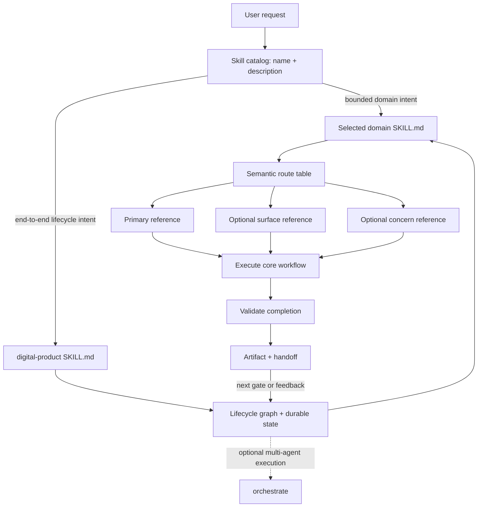

# Skill-Pack Navigation and Steering Research

Status: canonical navigation architecture
Date: 2026-07-16
Companion document: [Composable Skill Packs for the Digital Product Lifecycle](product-lifecycle-skill-packs-exploration.md)

Documentation map: [Digital Product Skills documentation](README.md)

Authoring standard: [High-Signal Skill Authoring Standard](high-signal-skill-authoring-standard.md)

Repository and release decision: [ADR-0003: Independent skill repositories](decisions/0003-independent-skill-repositories.md)

Identity and terminology decision: [ADR-0002: Product identity and terminology](decisions/0002-product-identity-and-terminology.md)

## Executive conclusion

The most effective structure is a **semantic router with progressive disclosure**:

```text
catalog metadata
    ↓ selects the skill
SKILL.md router + universal workflow
    ↓ selects only relevant modules
flat, self-describing reference files
    ↓ invokes when necessary
scripts, assets, external sources, or search
```

Use all of the following, but give each a different responsibility:

1. **The frontmatter description routes into the skill.** It determines whether the agent activates the pack.
2. **`SKILL.md` routes inside the skill.** It contains the minimum workflow that applies to every invocation and explicit rules for selecting supporting files.
3. **Standard relative Markdown links provide portable edges.** Every important reference should be directly reachable from `SKILL.md`.
4. **A compact route table acts as a semantic table of contents.** Each entry says when to read a file, when not to read it, and what it contributes.
5. **Focused reference files provide just-in-time depth.** Each reference begins with a self-description and contains one coherent body of knowledge.
6. **A TOC belongs inside a long reference.** It helps navigate within a selected file; it does not decide which file to select.
7. **Wiki links may power an authoring graph, but should not be the runtime contract.** Compile `[[prototyping]]` into a standard relative Markdown link targeting `references/prototyping.md` when exporting a portable skill.
8. **Search and retrieval are escape hatches for genuinely large or dynamic collections.** They should not replace clear routing in an ordinary skill pack.

In short:

> Use `SKILL.md` as a small decision-making router, not as an encyclopedia and not as a bare link directory.

Names shown as `/design` are documentation shorthand for the canonical skill identifier `design`. Invocation syntax belongs to the client, not the pack structure; Codex explicit invocation commonly uses `$design`.

The Agent Skills specification formalizes three levels of loading: metadata, the selected `SKILL.md`, and supporting resources loaded on demand. It recommends a main file below 500 lines, focused supporting files, relative paths, and references that remain one level deep from `SKILL.md`. [Agent Skills specification](https://agentskills.io/specification)

OpenAI documents the same progressive-disclosure behavior for Codex. Codex initially sees skill names, descriptions, and paths; its initial skill list has a limited context budget, and descriptions may be shortened when many skills are installed. OpenAI therefore recommends concise descriptions with scope, boundaries, and key trigger terms front-loaded. [OpenAI: Build skills](https://learn.chatgpt.com/docs/build-skills)

## 1. Research question

The practical question is not simply how to store many files. It is how to help an agent repeatedly answer four routing questions correctly:

1. **Should I activate this skill?**
2. **Which part of the skill applies to this request?**
3. **What must I read or run before acting?**
4. **When do I have enough context to execute and validate the task?**

This document calls those four layers:

- Activation steering.
- Traversal steering.
- Execution steering.
- Completion steering.

A pack is successful only when all four work. A well-organized reference library is useless if its description fails to trigger. A perfect trigger is also insufficient if `SKILL.md` causes the agent to load every file, choose the wrong branch, or stop before validation.

## 2. Evidence reviewed

The recommendation synthesizes the following primary sources and current implementations:

- [OpenAI: Build skills](https://learn.chatgpt.com/docs/build-skills) for current Codex discovery, progressive disclosure, description truncation, invocation policy, and packaging behavior.
- [OpenAI `skill-creator`](https://github.com/openai/skills/blob/main/skills/.system/skill-creator/SKILL.md) for the recommended anatomy, concise main file, conditional references, one-level reference structure, and validation workflow.
- [Agent Skills specification](https://agentskills.io/specification) for the portable file format and relative-link rules.
- [Agent Skills: best practices](https://agentskills.io/skill-creation/best-practices) for coherent scope, moderate detail, conditional loading, defaults, workflows, and validation loops.
- [Agent Skills: optimizing descriptions](https://agentskills.io/skill-creation/optimizing-descriptions) for trigger design and trigger evaluation.
- [Agent Skills: evaluating skills](https://agentskills.io/skill-creation/evaluating-skills) for controlled, baseline-comparative testing.
- [Agent Skills: using scripts](https://agentskills.io/skill-creation/using-scripts) for deterministic utilities and relative script references.
- [Anthropic: Equipping agents for the real world with Agent Skills](https://www.anthropic.com/engineering/equipping-agents-for-the-real-world-with-agent-skills) for the progressive-disclosure model and production motivation.
- [Anthropic: Effective context engineering for AI agents](https://www.anthropic.com/engineering/effective-context-engineering-for-ai-agents) for just-in-time retrieval, filesystem signals, and the costs of unguided exploration.
- [Lost in the Middle](https://arxiv.org/abs/2307.03172) for evidence that adding more context does not guarantee better use of that context and that relevant information can be underused in long inputs.
- [OpenAI `chatgpt-apps` skill](https://github.com/openai/skills/blob/main/skills/.curated/chatgpt-apps/SKILL.md) and [OpenAI `security-threat-model` skill](https://github.com/openai/skills/blob/main/skills/.curated/security-threat-model/SKILL.md) as current examples of direct, conditional reference routing.
- [Anthropic `mcp-builder` skill](https://github.com/anthropics/skills/blob/main/skills/mcp-builder/SKILL.md) as an example of workflow-phase and platform-specific routing.
- [Agent Skills `llms.txt`](https://agentskills.io/llms.txt) as a compact example of a link index in which every destination includes a short semantic description.

No official source found in this research publishes a controlled comparison of `[[wiki links]]` versus Markdown links versus a TOC inside an Agent Skill. The final choice among those mechanisms is therefore an architectural inference from documented loading behavior, portability requirements, context research, and production examples—not a claim that a published benchmark has proven one syntax universally superior.

## 3. How an agent actually encounters a skill

### 3.1 Tier 1: discovery metadata

At session start, the agent does not read every installed skill. It receives a catalog containing at least the skill's name and description. Codex also exposes the path. The description carries the activation burden.

This has several consequences:

- A one-word name such as `design` is memorable but not sufficiently discriminative by itself.
- The first words of the description have disproportionate routing value because a client may shorten descriptions when the catalog is large.
- Scope, trigger language, and near-miss exclusions matter more than explanatory prose.
- Information stored only in the `SKILL.md` body cannot help the initial activation decision.

Recommended description shape:

```yaml
---
name: design
description: Design digital-product experiences across websites, web apps, iOS, and Android. Use for UX research, information architecture, user journeys, task flows, wireframes, UI, content design, design systems, prototypes, usability testing, or frontend handoff. Do not use for production client implementation, backend architecture, or marketing strategy unless the request also requires experience design.
---
```

The sequence is deliberate:

1. Primary user outcome.
2. Supported surfaces.
3. Natural-language trigger concepts.
4. Important near-miss boundaries.

Do not spend the description budget explaining internal folders or scripts. Users do not ask for an internal routing mechanism; they ask for an outcome. The Agent Skills description guide explicitly recommends describing user intent rather than implementation and evaluating both positive and near-miss negative prompts. [Optimizing skill descriptions](https://agentskills.io/skill-creation/optimizing-descriptions)

### 3.2 Tier 2: the complete `SKILL.md`

After activation, the full main file enters context. This means everything in it has a cost on every invocation of the skill.

The main file should therefore contain only information with a high probability of being useful on every run:

- The skill's mission and ownership boundary.
- Input and output contract.
- Universal invariants.
- The core workflow.
- Conditional routing rules.
- Completion and validation requirements.
- Direct pointers to optional resources.

It should not contain:

- Full platform manuals.
- Exhaustive examples for every variant.
- Repeated explanations the base model already knows.
- Large templates.
- Detailed API schemas.
- Every edge case ever encountered.
- A separate prose chapter merely explaining the folder structure.

Official guidance recommends moderate detail because overly comprehensive skills make relevance extraction harder and can send the model down branches that do not apply. [Agent Skills best practices](https://agentskills.io/skill-creation/best-practices)

### 3.3 Tier 3: selected resources

References, scripts, and assets should be accessed only when the current route requires them.

- Read a reference when domain or variant knowledge is necessary.
- Run a script when deterministic behavior is safer or cheaper than token-based reasoning.
- Reuse an asset when it is material for the output.
- Search a large corpus only when direct routes are insufficient.

Anthropic describes this as just-in-time context: retain lightweight identifiers such as paths or links, then retrieve data at runtime. It also warns that unguided exploration can waste context and lead to dead ends, making explicit heuristics essential. [Effective context engineering](https://www.anthropic.com/engineering/effective-context-engineering-for-ai-agents)

## 4. Comparing navigation mechanisms

| Mechanism | Strength | Weakness | Recommended role |
|---|---|---|---|
| One monolithic `SKILL.md` | No navigation tool calls; all instructions immediately available | Every run pays the full token cost; irrelevant branches compete for attention | Small skills only |
| Plain TOC | Shows what files or sections exist | Does not explain when to choose them; encourages browsing by title | Navigation within long selected files |
| Semantic route table | Encodes conditions, destination, and expected contribution | Requires careful maintenance and testing | Primary in-pack router |
| Standard Markdown links | Portable, explicit target paths, human-readable | A link alone still needs routing language | Canonical runtime edges |
| Wiki links | Convenient for authoring graphs and backlinks | Not part of the Agent Skills standard; resolution depends on the host | Authoring metadata compiled on export |
| Reference-to-reference links | Can model a rich knowledge graph | Produces deep chains, cycles, and hidden dependencies | Avoid for required navigation |
| Directory listing | Easy to generate and inspect | Filenames alone can be ambiguous | Fallback discovery, not primary steering |
| Grep or scoped search | Efficient for large, known textual corpora | Query quality varies; can miss semantic matches | Large-file or large-pack fallback |
| Generated manifest | Machine-checkable inventory and metadata | Adds another format and synchronization burden | Optional validation/catalog artifact |
| Embedding or RAG retrieval | Scales to large or dynamic knowledge bases | Infrastructure, chunking, ranking, and stale-index complexity | Only beyond normal filesystem scale |

### 4.1 Why a TOC alone is insufficient

A TOC answers “what exists?” The agent needs “what applies now?”

Weak:

```markdown
## References

- research.md
- journeys.md
- ui.md
- prototypes.md
- ios.md
- android.md
```

Better:

```markdown
## Route the request

| When the request involves | Read | Expected contribution |
|---|---|---|
| Discovering needs or planning a design study | [Research](references/research.md) | Study plan, evidence, and synthesis |
| Mapping an end-to-end task or service interaction | [Journeys](references/journeys.md) | Journey map or task flow |
| Testing a concept before production implementation | [Prototyping](references/prototyping.md) | Classified prototype and learning plan |
| Applying native iOS behavior | [iOS](references/surface-ios.md) | Platform-specific interaction constraints |
```

The second form is a **semantic TOC**: it combines discoverability with a decision rule and an artifact expectation.

### 4.2 Why wiki links should not be the portable contract

The Agent Skills specification documents relative file references from the skill root and illustrates standard Markdown links. It does not define wiki-link resolution, backlinks, aliases, transclusion, or graph traversal. [Agent Skills specification](https://agentskills.io/specification)

Therefore:

```text
[[prototyping]]
```

may be useful in an authoring environment, but a portable runtime pack should export:

```markdown
[Prototyping](references/prototyping.md)
```

or an explicit path:

```markdown
Read `references/prototyping.md` when the user needs a disposable or production-shaped prototype.
```

The difference is not that an LLM cannot understand double brackets. It usually can. The problem is that the runtime may not resolve the target, the syntax carries no standardized execution behavior, and hidden backlink graphs invite uncontrolled traversal.

For a graph-based authoring interface, wiki links may still be valuable as an authoring abstraction:

```text
Authoring graph: [[prototyping]]
Export adapter:  [Prototyping](references/prototyping.md)
Runtime action:  Read the file only when the route condition matches.
```

This preserves visual composition and backlinks in an authoring product without coupling Digital Product Skills to that product or to a proprietary link syntax.

### 4.3 Why deep link graphs are harmful inside a skill

The portable specification says to keep references one level deep from `SKILL.md` and avoid deeply nested reference chains. This is operationally useful because deep graphs create:

- Extra tool calls.
- More opportunities to miss an instruction.
- Cycles.
- Hidden prerequisites.
- Unclear stopping conditions.
- Greater dependence on filename intuition.
- Harder validation and portability.

Required traversal should look like this:

```text
SKILL.md ──> references/prototyping.md
         ├─> references/surface-ios.md
         └─> references/handoff.md
```

Avoid:

```text
SKILL.md
  └─> references/index.md
        └─> references/design/prototypes/index.md
              └─> references/design/prototypes/mobile.md
                    └─> references/platforms/ios/gestures.md
```

If a route needs three modules, list all three directly in `SKILL.md`. If the direct route table becomes unmanageable, that is evidence that the skill may be too broad or that references should be consolidated—not evidence that another navigation layer is automatically needed.

## 5. Recommended navigation architecture

### 5.1 Layer A: activation router

Location: frontmatter `description`.

It should contain:

- Primary job.
- User-intent synonyms.
- Supported artifact or surface terms.
- Important indirect triggers.
- Near-miss exclusions where adjacent skills overlap.

It should not contain:

- Internal routes.
- File paths.
- Full workflows.
- Marketing copy.

### 5.2 Layer B: in-pack router

Location: near the top of `SKILL.md`, immediately after the mission and operating contract.

It should classify the request across a few independent facets:

1. **Primary job** — what result is being requested?
2. **Surface or environment** — website, web app, iOS, Android, or another variant.
3. **Concern overlay** — accessibility, security, SEO, performance, privacy, and similar concerns.
4. **Lifecycle mode** — standalone work, upstream consumption, implementation handoff, or validation.

This faceted approach avoids a combinatorial route table. The agent can select one primary module, zero or one surface overlay, and only the relevant concern modules.

Example:

```text
Request: Prototype an accessible onboarding flow for an iOS app.

Primary route:  prototyping.md
Surface overlay: surface-ios.md
Concern overlay: accessibility.md
Lifecycle route: handoff.md, only if production implementation is requested
```

### 5.3 Layer C: reference leaves

Location: a flat `references/` directory.

Each file should be:

- Focused on one coherent decision domain.
- Named with concrete nouns an agent will recognize.
- Directly referenced from `SKILL.md`.
- Small enough to read completely when selected.
- Self-describing at the beginning.
- Free from required second-hop navigation.
- Explicit about inputs, outputs, boundaries, and validation.

Recommended header:

```markdown
# Prototyping

Purpose: Select and build the cheapest prototype that can answer the current product or design question.

Read when:
- The user asks for a prototype, proof of concept, clickable flow, or interaction experiment.
- The team needs to test experience behavior before production implementation.

Skip when:
- The request is solely for production-ready frontend implementation.
- The uncertainty is technical feasibility rather than user experience; route that work to `/architecture`.

Inputs:
- Hypothesis or decision to inform.
- Audience and surface.
- Known constraints.

Produces:
- Prototype classification.
- Prototype artifact.
- Test plan and findings.
- Production-readiness caveats.
```

This header makes the file self-routing even after it has been loaded and places the most important context at its beginning.

### 5.4 Layer D: deterministic and external resources

Use:

- `scripts/` for repeatable or fragile operations.
- `assets/` for material copied into outputs.
- MCP or connectors for live systems and authorized private data.
- Web or official documentation for current public facts.
- Search for large local corpora.

The main router should say whether a script must be **run** or **read**. Anthropic notes that code can act as executable logic or documentation and that this distinction should be explicit. [Equipping agents with skills](https://www.anthropic.com/engineering/equipping-agents-for-the-real-world-with-agent-skills)

## 6. Recommended pack structure

```text
design/
├── SKILL.md
├── agents/
│   └── openai.yaml
├── references/
│   ├── research.md
│   ├── journeys.md
│   ├── information-architecture.md
│   ├── interaction.md
│   ├── visual-ui.md
│   ├── content.md
│   ├── accessibility.md
│   ├── prototyping.md
│   ├── design-systems.md
│   ├── usability-testing.md
│   ├── handoff.md
│   ├── surface-website.md
│   ├── surface-webapp.md
│   ├── surface-ios.md
│   └── surface-android.md
├── scripts/
│   └── validate-handoff.*
└── assets/
    ├── brief-template.md
    ├── research-plan-template.md
    └── prototype-starters/
```

The flat reference directory is intentional. Prefix variants such as `surface-ios.md` rather than nesting `references/surfaces/mobile/ios.md`.

Do not add an `INDEX.md` merely because the folder contains several files. The semantic router in `SKILL.md` already serves as the index. Add a separate generated inventory only if a tool, website, or validator needs it; do not force the agent through it during ordinary execution.

## 7. Recommended `SKILL.md` shape

```markdown
---
name: design
description: Design digital-product experiences across websites, web apps, iOS, and Android. Use for UX research, information architecture, user journeys, task flows, wireframes, UI, content design, design systems, prototypes, usability testing, or frontend handoff. Do not use for production client implementation, backend architecture, or marketing strategy unless the request also requires experience design.
---

# Experience Design

## Mission and boundary

Design how people understand, navigate, and interact with a digital product.
Own experience intent and design artifacts. Do not present prototype code as production-ready implementation.

## Route before acting

1. Identify the primary design job.
2. Select at most one surface overlay unless the task explicitly compares platforms.
3. Add only the concern overlays that materially affect the request.
4. Read every selected reference completely before producing the affected artifact.
5. Do not scan or load unrelated references.

### Primary job

| User intent | Read | Produce |
|---|---|---|
| Plan or synthesize UX research | [Research](references/research.md) | Research plan or synthesis |
| Map a journey or task flow | [Journeys](references/journeys.md) | Journey map or flow |
| Structure content and navigation | [Information architecture](references/information-architecture.md) | Sitemap, hierarchy, navigation model |
| Define behavior and states | [Interaction](references/interaction.md) | Interaction and state specification |
| Define visual UI | [Visual UI](references/visual-ui.md) | Screen or component direction |
| Create or evaluate a prototype | [Prototyping](references/prototyping.md) | Classified prototype and test plan |
| Establish reusable components or tokens | [Design systems](references/design-systems.md) | System specification |
| Test usability | [Usability testing](references/usability-testing.md) | Test plan and findings |
| Prepare implementation handoff | [Handoff](references/handoff.md) | Frontend-ready specification |

### Surface overlay

| Surface | Read |
|---|---|
| Marketing or content website | [Website](references/surface-website.md) |
| Interactive browser application | [Web app](references/surface-webapp.md) |
| Native iOS application | [iOS](references/surface-ios.md) |
| Native Android application | [Android](references/surface-android.md) |

### Concern overlay

- Read [Accessibility](references/accessibility.md) for an accessibility audit, complex interaction, assistive-technology behavior, or explicit WCAG requirement.
- Read [Content](references/content.md) when labels, instructions, error language, or content hierarchy materially affect the outcome.

## Universal invariants

- Include loading, empty, success, error, permission, and recovery states when relevant.
- Treat accessibility as a design constraint even when the detailed accessibility reference is unnecessary.
- State whether coded artifacts are disposable prototypes, design references, or production candidates.
- Preserve established product and architecture constraints or report conflicts explicitly.

## Core workflow

1. Inspect the request, available evidence, and existing artifacts.
2. Route to the smallest sufficient reference set.
3. State material assumptions.
4. Produce the requested design artifact.
5. Validate it against the user goal, constraints, edge states, and acceptance criteria.
6. Provide a structured handoff when downstream implementation is expected.

## Completion

- Confirm that the requested artifact exists.
- Record decisions, assumptions, risks, and unresolved questions.
- Identify validation performed and validation remaining.
- Recommend, but do not automatically invoke, the next skill pack.
```

This shape keeps the universal behavior in context while moving conditional depth to reference leaves.

## 8. Router-writing rules

### 8.1 Use observable conditions

Weak:

```markdown
See `references/prototyping.md` for more information.
```

Strong:

```markdown
Read `references/prototyping.md` when the user asks for a clickable concept, interaction experiment, coded design exploration, or other artifact intended to reduce uncertainty before production implementation.
```

### 8.2 State exclusions for close neighbors

```markdown
Do not use the prototyping route for a purely technical feasibility spike; recommend `/architecture`. Do not classify production frontend work as a prototype merely because it begins from a mockup.
```

Exclusions are most valuable where two routes share vocabulary.

### 8.3 State what the route contributes

A route is easier to select when it names an output:

```markdown
Read `references/journeys.md` to produce a journey map, task flow, or service blueprint with actors, stages, transitions, pain points, and opportunities.
```

### 8.4 Prefer defaults over equal menus

If three methods could work, choose a default and state the exception:

```markdown
Default to a low-fidelity interactive prototype for flow validation. Use high visual fidelity only when the question concerns visual hierarchy, brand expression, or stakeholder approval.
```

Agent Skills guidance recommends defaults because equal-option menus add ambiguity and decision overhead. [Best practices](https://agentskills.io/skill-creation/best-practices)

### 8.5 Put universal rules in the main file

If a rule applies on nearly every route, do not hide it in a reference the agent might not load.

Examples:

- Never call prototype code production-ready without verification.
- Preserve user-provided constraints.
- Validate requested artifacts before completion.
- Record material assumptions.

### 8.6 Put rare rules in the branch that needs them

Examples:

- iOS-specific navigation behavior.
- SEO canonical rules.
- Payment security details.
- A particular model provider's API schema.

### 8.7 Avoid duplicate truth

Do not summarize a detailed reference so fully in `SKILL.md` that both files must be maintained. The main file owns the route and invariant; the reference owns the procedure and depth.

## 9. Reference-file design

### 9.1 Size and cohesion

There is no universal ideal line count, but the selected file should be small enough to read without flooding the task context.

Practical heuristic:

- Under roughly 100 lines: headings are usually sufficient.
- Above roughly 100 lines: add a compact contents list, consistent with the local OpenAI `skill-creator` guidance.
- If a file regularly exceeds a few hundred lines and contains separable concerns, split it into coherent sibling references directly routed from `SKILL.md`.
- If splitting would create several files that are always loaded together, keep them together; token savings only exist when branches are actually conditional.

### 9.2 Primacy header

Start every reference with:

- Purpose.
- Read when.
- Skip when.
- Inputs.
- Outputs.
- Any safety or maturity classification.

Long-context research shows that the position and amount of information can affect model use of context. This does not prove a particular header template, but it supports placing critical routing and constraints at the beginning rather than burying them in the middle. [Lost in the Middle](https://arxiv.org/abs/2307.03172)

### 9.3 TOC inside long references

A contents list is useful after the file has already been selected:

```markdown
## Contents

- Prototype selection
- Fidelity model
- Coded prototypes
- Validation methods
- Production-readiness handoff
- Failure modes
```

Keep it descriptive and short. It is not a substitute for the `SKILL.md` routing condition.

### 9.4 Stable filenames

Prefer:

```text
prototyping.md
usability-testing.md
surface-ios.md
seo-technical.md
```

Avoid:

```text
misc.md
notes.md
advanced.md
guide-2.md
new-version-final.md
```

Anthropic's context-engineering guidance notes that paths and naming conventions provide useful semantic signals to filesystem-capable agents. [Effective context engineering](https://www.anthropic.com/engineering/effective-context-engineering-for-ai-agents)

### 9.5 No required lateral traversal

A reference may mention related modules, but it should not require the agent to discover mandatory next files through a chain. If two references are required together, encode that bundle in the main router:

```markdown
For a native iOS prototype, read both [Prototyping](references/prototyping.md) and [iOS](references/surface-ios.md).
```

## 10. When to add an index, manifest, search, or retrieval

### 10.1 Ordinary pack

Use only the `SKILL.md` router when:

- The pack has a modest number of coherent references.
- Filenames and route conditions are stable.
- Each task needs only a few modules.
- The main route table remains readable.

This should cover the proposed lifecycle packs.

### 10.2 Large but coherent pack

Before adding an index layer:

1. Remove knowledge the model already has.
2. Merge tiny references that are always loaded together.
3. Split a genuinely independent workflow into another skill.
4. Group the main router by facets or workflow phases.
5. Add scoped grep patterns for unusually large files.

If the pack remains coherent, an optional generated manifest may support linting and the website:

```yaml
references:
  - path: references/prototyping.md
    intent: prototype an experience before production
    outputs: [prototype, test-plan, findings]
    aliases: [clickable-concept, proof-of-concept]
```

Do not make this a second source of truth. Generate it from the router or validate it against the router.

### 10.3 Very large or dynamic knowledge

Use search, MCP, or retrieval when:

- Knowledge changes independently of the installed skill.
- There are hundreds or thousands of documents.
- The same query may need evidence from many sources.
- Maintaining direct routes would be unrealistic.
- Access control or live system state matters.

At that point, the skill should describe the retrieval workflow and source priorities rather than bundle the entire knowledge base.

## 11. Walkability for agents and humans

A walkable pack lets either an agent or a human answer these questions quickly:

1. What does this skill own?
2. What does it explicitly not own?
3. Which route matches this request?
4. What files will be loaded?
5. What artifact will each file help produce?
6. What is always required?
7. How is completion validated?
8. What should happen next in a pipeline?

Design for scanability:

- Put mission, boundary, and route near the top.
- Use predictable headings across every pack.
- Use tables for exact route mappings.
- Keep link labels semantic.
- Use the same vocabulary in the description, router, filenames, catalog aliases, and evals.
- Put optional explanations after the actionable rules.
- Keep examples canonical rather than exhaustive.

Do not optimize solely for attractive human documentation. An agent needs imperative routing and execution rules, not a narrative book chapter.

## 12. Navigation across independent repositories and composed lifecycles

There are three separate routing systems:

### 12.1 Between domain skills

When the user invokes `/digital-product`, it selects compatible installed domain skills, creates the dependency graph, passes artifacts, and maintains lifecycle state:

```text
/product → /design → /frontend → /quality → /operate
```

Each domain skill lives in its own `<skill>-skill` repository and remains independently invocable. A domain skill may recommend a neighbor but does not silently invoke it. The explicit `/digital-product` request is what authorizes cross-skill composition.

### 12.2 Inside one pack

The selected `SKILL.md` chooses references:

```text
/design
  ├─ primary: prototyping.md
  ├─ surface: surface-ios.md
  └─ concern: accessibility.md
```

### 12.3 Across agents

The separate `/orchestrate` skill may assign or coordinate work across multiple agents. It does not choose the digital-product lifecycle or own lifecycle state. `/digital-product` must remain executable without it.

Do not blur these levels. Lifecycle composition belongs to `/digital-product`; internal domain navigation belongs to the selected skill's `SKILL.md`; multi-agent execution belongs to `/orchestrate` when that optional mechanism is used.

## 13. Evaluation plan for routing quality

Structure alone cannot guarantee good steering. Test the actual agent trajectory.

### 13.1 Activation evaluation

For each skill, create:

- 8–10 prompts that should trigger.
- 8–10 prompts that should not trigger.
- Near-miss negative cases involving adjacent skills.
- Explicit and implicit wording.
- Short, long, formal, casual, and typo-heavy prompts.

Example near misses for `/design`:

```json
[
  {
    "query": "Prototype a clearer mobile onboarding flow and test it with five users",
    "should_trigger": true
  },
  {
    "query": "Implement the approved onboarding screens in our SwiftUI production app",
    "should_trigger": false
  },
  {
    "query": "Choose a backend architecture for storing onboarding progress",
    "should_trigger": false
  }
]
```

Run each prompt multiple times because model behavior is nondeterministic. The Agent Skills optimization guide proposes three runs as a reasonable starting point. [Optimizing skill descriptions](https://agentskills.io/skill-creation/optimizing-descriptions)

### 13.2 Traversal evaluation

For each prompt, define expected and forbidden reads:

```json
{
  "prompt": "Create an accessible iOS onboarding prototype",
  "expected_references": [
    "references/prototyping.md",
    "references/surface-ios.md",
    "references/accessibility.md"
  ],
  "forbidden_references": [
    "references/surface-android.md",
    "references/design-systems.md"
  ]
}
```

Measure:

- Correct route selected.
- Required-reference recall.
- Irrelevant-reference reads.
- Number of file reads.
- Navigation dead ends.
- Token cost.
- Time to first productive action.

### 13.3 Execution evaluation

Routing is only useful if the output improves. Compare:

- Current skill.
- Proposed router structure.
- No skill or the previous version.

Use objective assertions where possible and human review for judgment-heavy artifacts. The official evaluation guide recommends baseline comparison, isolated contexts, recorded token/time costs, evidence-backed assertions, and iteration from execution traces. [Evaluating skill output quality](https://agentskills.io/skill-creation/evaluating-skills)

### 13.4 Failure taxonomy

Classify failures so the correct layer gets fixed:

| Failure | Fix location |
|---|---|
| Skill did not activate | Frontmatter description |
| Wrong skill activated | Description boundaries and near-miss exclusions |
| Correct skill, wrong module | `SKILL.md` route conditions |
| Too many modules loaded | Route specificity or pack scope |
| Required module missed | Direct route or trigger vocabulary |
| Correct references, poor execution | Reference procedure or examples |
| Correct work, incomplete output | Completion contract |
| Repeated mechanical error | Tested script or validator |
| Broken path or orphan reference | Structural linting |

## 14. Structural linting recommendations

A small validator should check:

- Valid `SKILL.md` frontmatter.
- Skill name matches its directory.
- Main file line and token budget warnings.
- Every runtime reference uses a valid relative path.
- Every reference file is reachable directly from `SKILL.md`.
- No required reference-to-reference chain exists.
- No unresolved wiki links remain in an exported pack.
- Every reference begins with purpose and routing metadata.
- Long references contain a compact TOC.
- Scripts mentioned by the workflow exist and expose usable help or errors.
- Assets mentioned by the workflow exist.
- No duplicate reference names differ only by case.
- Trigger and traversal eval files exist for mature packs.

This validator is a strong candidate for a reusable repository-local build tool. Each `<skill>-skill` repository should run it against its own runtime pack; `digital-product-skill` should add compatibility and composition checks. The validator should not become another skill reference the agent must read.

## 15. Scaling heuristics

These are starting heuristics to validate, not specification limits:

| Signal | Recommended response |
|---|---|
| `SKILL.md` is below roughly 150–250 lines and every section applies often | Keep it self-contained |
| `SKILL.md` approaches 500 lines or contains mutually exclusive variants | Move variant details into direct references |
| A reference exceeds roughly 100 lines | Add a compact TOC |
| A reference exceeds a few hundred lines with separable concerns | Split into sibling references routed directly from `SKILL.md` |
| Two references are always loaded together | Consider merging them |
| More than roughly 15–20 reference routes are needed | Reassess pack scope before adding another index layer |
| The corpus is dynamic or contains hundreds of sources | Use search, MCP, or retrieval |
| A procedure is rewritten or fails mechanically across runs | Bundle and test a script |

The correct thresholds should ultimately come from traversal and output evals rather than aesthetics.

## 16. Recommended conventions for every lifecycle skill repository

Use the same top-level order:

```text
frontmatter
mission and boundary
route before acting
primary routes
variant/surface routes
concern overlays
universal invariants
core workflow
completion and handoff
```

Use the same reference header:

```text
purpose
read when
skip when
inputs
produces
contents, if long
domain procedure
validation
failure modes
```

Use the same route language:

- “Read X when…”
- “Skip X when…”
- “Run X to…”
- “Use asset X as…”
- “Recommend skill X when…”
- “Do not automatically invoke…”

Consistency makes every new pack easier for the agent and maintainers to traverse.

## 17. Decisions for Digital Product Skills

### Adopt

- `SKILL.md` as the canonical in-pack router.
- Standard relative Markdown paths in exported skills.
- Conditional route descriptions rather than bare file lists.
- Flat reference leaves.
- Self-describing headers.
- TOCs inside long references.
- Structural linting and navigation evals.
- Wiki-link authoring with export compilation, if the visual graph benefits from it.

### Avoid

- Wiki links as the only runtime link representation.
- A mandatory `INDEX.md` hop for ordinary packs.
- Deep directories and reference chains.
- Loading all references at activation.
- Huge main files that act as encyclopedias.
- Bare TOCs without selection criteria.
- RAG infrastructure for a modest, stable skill.
- Treating file organization as a substitute for route evaluation.

### Preserve

- One independently owned `<skill>-skill` repository per skill.
- `/digital-product` as the lifecycle composition and progress-tracking skill.
- `/orchestrate` as a separate optional multi-agent capability.
- Versioned lifecycle handoff contracts owned by `digital-product-skill` and implemented optionally by domain repositories.
- Domain ownership and cross-cutting overlays.
- Website categories as distributed storefront metadata rather than runtime or repository nesting.

## 18. Final recommendation

For Digital Product Skills, use this navigation contract:



The key design principle is **bounded agency**:

- Give the agent enough structure to select the right route.
- Give it freedom inside the selected domain where judgment is valuable.
- Avoid making it browse an unbounded knowledge graph.
- Avoid loading knowledge it does not need.
- Validate the observed route, not just the appearance of the files.

The practical answer to “wiki links, a TOC, or a router?” is therefore:

```text
Router in SKILL.md: yes, canonical
Conditional standard links: yes, canonical
TOC: yes, inside long selected references
Wiki links: optional authoring layer, compile on export
Deep graph traversal: no
Search/RAG: only when scale justifies it
```

This structure offers the best balance of triggering reliability, token efficiency, portability, human walkability, agent traversal, maintenance, and pipeline composition supported by the current evidence.
